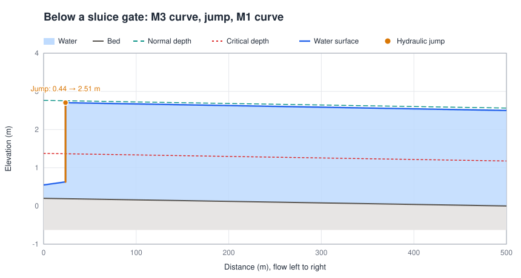
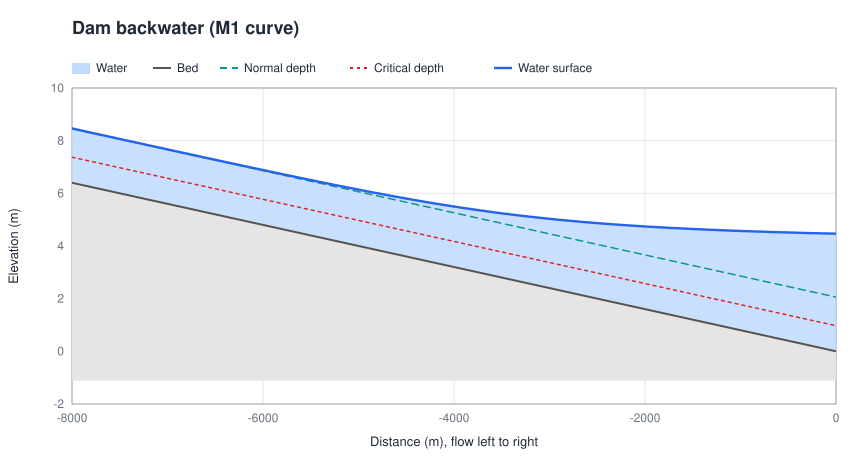
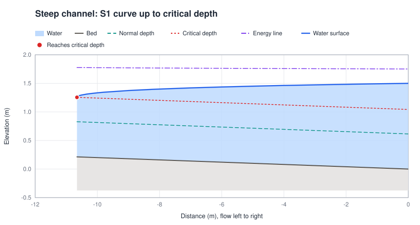
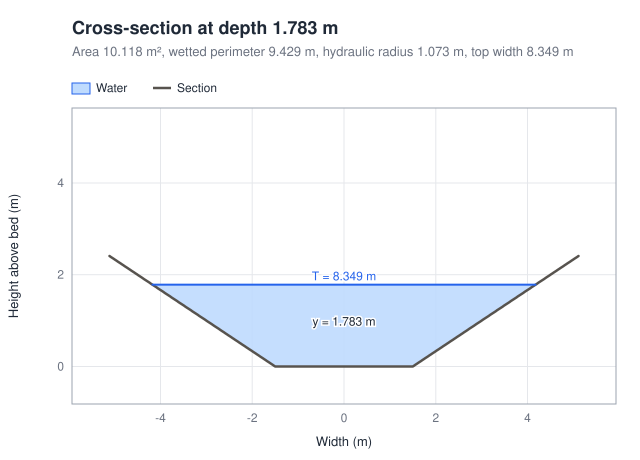
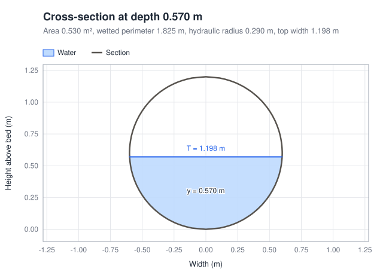
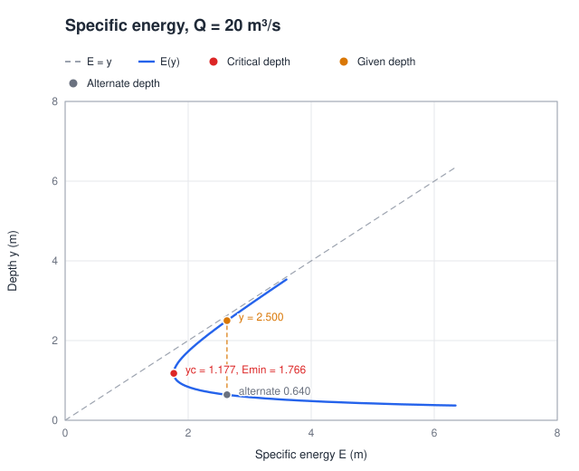
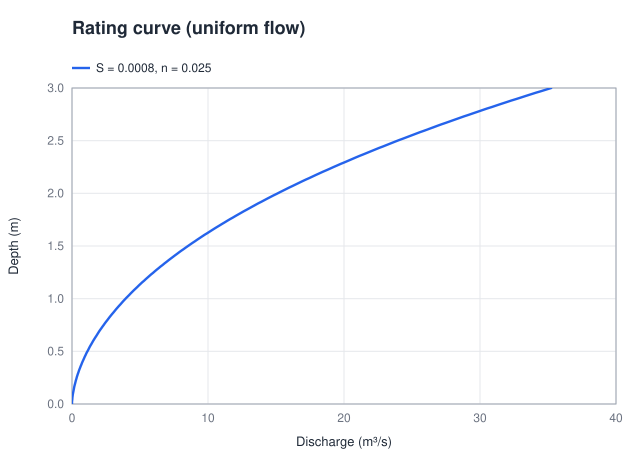

# Plots and profiles with a jump

PyOpenChannel draws its own charts as SVG files, with no plotting library. Each function in `pyopenchannel.plot` returns a figure: save it with `.save("name.svg")`, open it in the browser with `.show()`, or let a Jupyter notebook display it inline. SVG files stay sharp at any zoom and open in any browser.

The figures on this page were made by these functions (`tools/make_doc_plots.py` in the repository).

## Profiles with a hydraulic jump

Below a sluice gate the flow leaves as a supercritical jet; further down, a weir or the tailwater holds the water at a subcritical depth. `solve_profile_with_jump` computes the supercritical curve downstream from the gate and the subcritical curve upstream from the weir, and puts the jump where the two depths are sequent (equal momentum, A·ȳ + Q²/gA).

```python
import pyopenchannel as poc
from pyopenchannel import plot

reach = poc.solve_profile_with_jump(
    poc.RectangularChannel(width=5.0), discharge=20.0, slope=0.0004, manning_n=0.015,
    x_start=0.0, x_end=500.0,
    upstream_depth=0.35,     # jet below the gate (supercritical)
    downstream_depth=2.5,    # held by a weir (subcritical)
)

print(reach.message)         # Hydraulic jump at x = 23.64: 0.440 to 2.513
jump = reach.jump
print(jump.froude_number, jump.energy_loss, jump.length)   # 4.38, 2.02 m, 15.3 m

plot.profile(reach).save("profile.svg")
```



If the tailwater is high enough, the jump is drowned at the gate and the whole reach is subcritical; if the reach is too short for the jump, the supercritical flow sweeps it out downstream. The result's `message` and `notes` say which happened, and `jump` is `None` in both cases. The jump is drawn as a step at its toe; `jump.length` is about 6.1 times the sequent depth (USBR).

## Water surface profiles

`plot.profile` accepts a profile from `GVFSolver.solve_profile`, a profile with a jump, or the result of `DamAnalysis`, `BridgeAnalysis`, `ChuteAnalysis` or `ChannelTransition`. It draws the bed, the water, normal and critical depth, and marks where a profile reached critical depth. Pass `show_energy_line=True` to add the energy grade line.

```python
analysis = poc.DamAnalysis().analyze_backwater(
    poc.RectangularChannel(width=10.0), 30.0, 0.0008, 0.025, dam_height=2.0, analysis_distance=8000.0)
plot.profile(analysis, title="Dam backwater (M1 curve)").save("dam.svg")
```





Profiles come with at least 200 points over the reach, so curves are smooth however far apart the solver's steps are.

## Cross-sections

`plot.cross_section(channel, depth)` draws the section to scale with the water in it, and lists the area, wetted perimeter, hydraulic radius and top width.





## Specific energy and rating curves

`plot.specific_energy(channel, discharge, depth=None)` draws E = y + Q²/(2gA²), marks critical depth and minimum energy and, if you give a depth, its alternate depth. `plot.rating_curve(channel, slope, manning_n, max_depth)` draws normal depth against discharge.





## Units

Axis labels follow the unit system: metres and m³/s, or feet and ft³/s after `poc.set_unit_system(poc.UnitSystem.US_CUSTOMARY)`.
